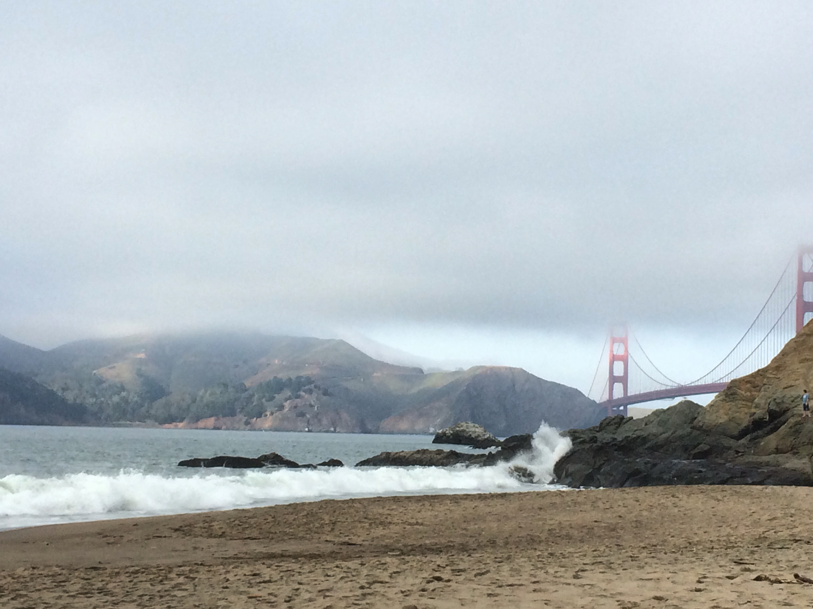
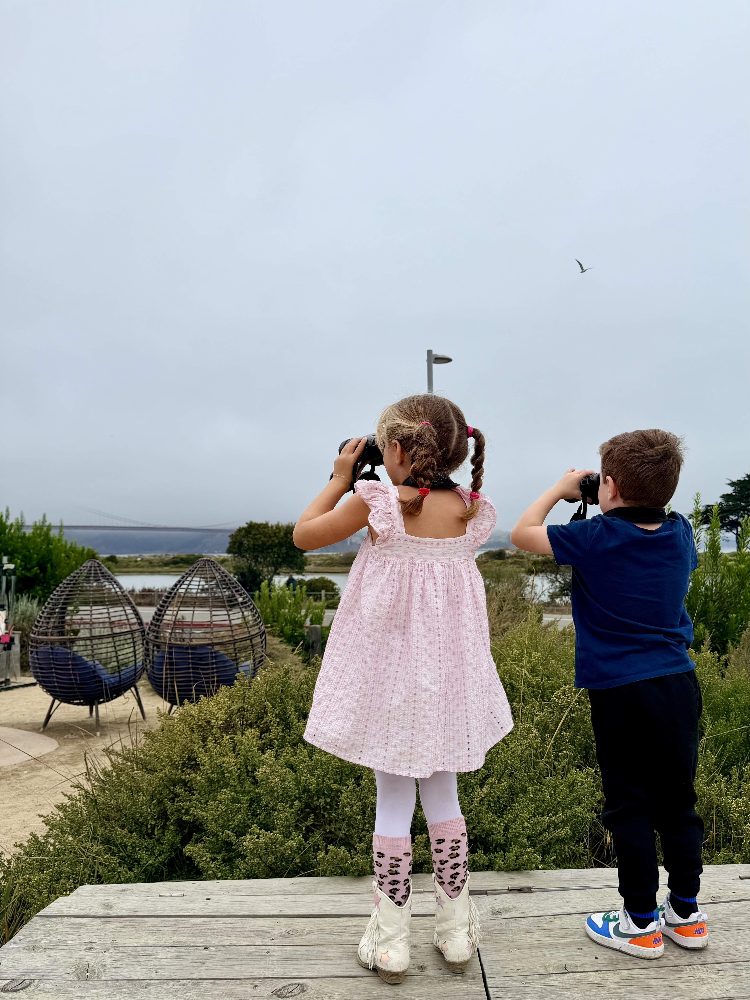
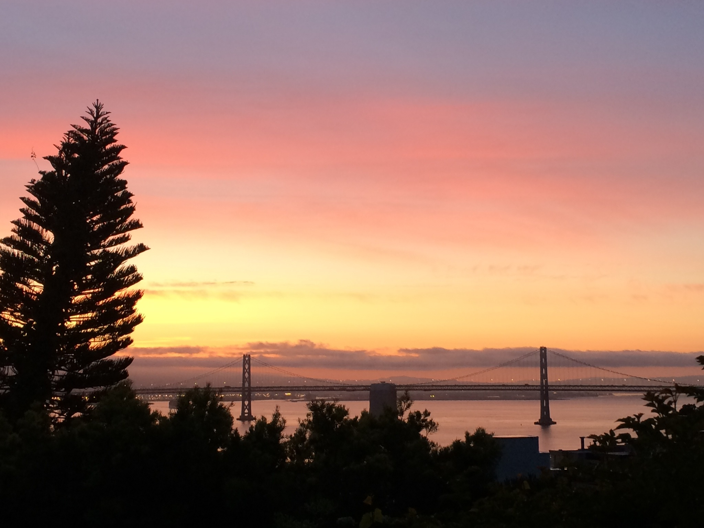

San Francisco is a different kind of destination for us. My husband and I lived here for eight and ten years, respectively–both before kids and with them–so we’ve experienced the city from almost every angle. Because of that, there isn’t one “right” itinerary to share. The perfect San Francisco plan depends entirely on the season, the day of the week, and who you’re traveling with. 

This was our first trip back since leaving in 2021, and it most definitely won’t be our last. So we didn’t rush to do it all. We prioritized time with friends while still giving the kids a taste of the city where they first lived. Below is how we spent our days, followed by my favorite food, drink, and family-friendly recommendations to help you plan your own visit. 

## Day 1: Travel Day
**🚗 Getting There:** Drove up from San Diego

**🏨 Stay:** [Infinity Hotel San Francisco, Tapestry Collection](https://www.hilton.com/en/hotels/sfoinup-infinity-hotel-san-francisco/?SEO_id=GMB-AMER-UP-SFOINUP)
  - Honestly? Not one I’d recommend. The rooms are tiny and dark. We booked it because it’s a Hilton (we’re Diamond members), it has a rooftop, and it sits in the heart of the Marina District.
  - Next time, we’ll choose one of the nicer hotels in Fisherman’s Wharf, which is still walkable to North Beach and the Marina
  - Don’t need to be walkable? The Fairmont is the most beautiful hotel in the city, with views to match

**Evening:** 
  - Met with friends and scootered along the Marina green
  - Ice cream from a food truck and playtime on the lawn
  - Walked back into the Marina for dinner at [NaPizza](https://www.napizzasf.com/)

## Day 2: The Presidio
**Breakfast:** [Home Plate](https://www.sfhomeplate.com/)

**Morning:** [Presidio Tunnel Tops Playground](https://presidio.gov/explore/attractions/outpost-playground)
  - Creative playground, big lawns, and Golden Gate Bridge views while the kids run wild

*📍 Presidio Tunnel Tops Playground*

**Lunch:** [Off the Grid Food Trucks](https://offthegrid.com/event/presidio-picnic) at Presidio Lawn
  - We picnicked with friends. Plenty of options for picky eaters and adventurous ones alike

**Afternoon:** [Presidio Bowl](https://www.presidiobowl.com/)
  - 6 adults and 8 kids. Chaotic in the best possible way.

**Dinner:** [Delarosa](https://www.delarosasf.com/location/marina/)

## Day 3: Alcatraz and Across the Bridge
**Breakfast:** [Twisted St. Cafe](https://www.twistedstcafe.com/) (right next door to the hotel)

**Morning:** [Alcatraz](https://alcatrazcitycruises.com/tickets/)
  - This was a huge hit with both kids (6 and 4). They listened to the audio tour, asked questions, and were fascinated with the jail cells. They still talk about Alcatraz today!
  - Book tickets well in advance–they will sell out.

**Lunch:** [Lucca Delicatessen](https://luccafooddeli.com/en-US)

**Afternoon:** [Bay Area Discovery Museum](https://bayareadiscoverymuseum.org/plan-your-visit/)

**Dinner:** Takeout from [Mixt Greens](https://www.mixt.com/locations/cow-hollow/?utm_source=gmb&utm_medium=organic&utm_campaign=website) and [Shake Shack](https://shakeshack.com/location/cow-hollow-ca#/), eaten on the hotel rooftop

## Day 4: Ferry Building, then Home
**Breakfast:** [Twisted St. Cafe](https://www.twistedstcafe.com/)

**Morning:** [Ferry Building Farmer's Market](https://foodwise.org/markets/ferry-plaza-farmers-market/?gad_source=1&gad_campaignid=164782136&gbraid=0AAAAADqmhSCyrlUe5qbiV-jXbupUSzzrk&gclid=Cj0KCQiAzeXXBhCGARIsADO5-zHCTvDDPcEBKjjmFhhXSNfmvkga6v3oD-Q1DQq5qq3KMj28nyAMfgIaAgOsEALw_wcB) and [Exploratorium](https://www.exploratorium.edu/)

**Lunch:** [Gott's Roadside](https://www.gotts.com/location/sfferrybuilding/) (inside the Ferry Building)

**Afternoon:** We called an audible and drove home after lunch rather than hitting the road at 5AM the next day. No regrets.

## Final Thoughts
San Francisco stole our hearts years ago, and coming back as a family of four felt like coming home. We reconnected with friends, showed the kids where they first lived, and spent a little time being tourists in our old city. We didn’t get to nearly everything (hello, Golden Gate Park!), but that just means this was the first of many trips back. With the right mix of neighborhoods, playgrounds, and good food, San Francisco is every bit as magical with kids as it was without them.

## More San Francisco Favorites
**Eat & Drink:**
  - [Buena Vista](https://www.thebuenavista.com/home/home.html)(Russian Hill): Faous Irish Coffee, plus a full breakfast for the family
  - [Arsicault Bakery](https://arsicault-bakery.com/)(Inner Richmond): Croissants worth the line. Go early.
  - [Tony's Pizza](https://tonyspizzanapoletana.com/)(North Beach): Grab slices next door and picnic in Washington Square Park
  - [4505 Burgers & BBQ](https://www.4505burgersandbbq.com/menus/)(Nopa): Smoked meats, burgers, and a family-friendly patio
  - [Cellarmaker House of Pizza](https://cellarmakerbrewing.com/san-francisco/): Beer for the parents, pizza for the kids

**Get Outside**
  - [Lands End](https://www.nps.gov/places/000/lands-end-trailhead.htm): Coastal hike with bridge views
  - [Muir Woods](https://www.visitcalifornia.com/experience/muir-woods-national-monument/?gad_source=1&gclid=Cj0KCQjwgrO4BhC2ARIsAKQ7zUl8keOCUg6WXhMfR3wfx9o9O4KAVTURMiucnOD6dm6Vsm3sd_j8GzYaArEyEALw_wcB): Easy redwood walks; reservations required.

**For the Kids**
  - [California Academy of Sciences](https://www.calacademy.org/exhibits/osher-rainforest?gad_source=1&gclid=Cj0KCQiA9667BhDoARIsANnamQYgux4V86eJP6DTYu7Sn7N3fcPhiYNodNRrHTQX44FsCWX4mu88tx8aAvm7EALw_wcB): Aquarium, planetarium, and rainforest under one roof
  - [Children's Fairyland](https://fairyland.org/?gad_source=1&gclid=Cj0KCQiA9667BhDoARIsANnamQbAjvAPy12aiWfLOFkNmqBt7QJtzNoFpYMNXffvQgc7ZrtvuVjepkoaAn7OEALw_wcB) (Oakland): Whimsical play for little ones
  - [Golden Gate Fortune Cookie Factory](https://www.goldengatefortunecookies.com/history): Watch fortune cookies made by hand
  - [Koret Children's Playground](https://sfrecpark.org/Facilities/Facility/Details/Koret-Childrens-Quarter-and-Carousel-414): Playground inside Golden Gate Park

**Touristy, With a Twist**
  - Bike Across the Golden Gate Bridge: Ride to [Bar Bocce](https://barbocce.com/) in Sausalito and ferry back (best with older kids)
  - McCovey Cove: Kayak outside Oracle Park during a Giants' game
  - [16th Ave Tiled Steps](https://www.16thavenuetiledsteps.com/): A colorful climb with 360-degree views
  - Dear San Francisco at [Club Fugazi](https://dearsf.clubfugazisf.com/?utm_source=google&utm_medium=sc_brand&utm_campaign=395856_sfo&utm_content=769175894137&utm_term=club%20fugazi%20san%20francisco_b&gad_source=1&gad_campaignid=22891807853&gbraid=0AAAAADGO9U_dRU59aliwgTFL05SoYFI9w&gclid=Cj0KCQiAzeXXBhCGARIsADO5-zEu2yX92W1SkBTGHZLD5syEymBvG2NqbtJygPQ53c_ZL24SyXU_9roaAixrEALw_wcB): A circus show and love letter to the city
